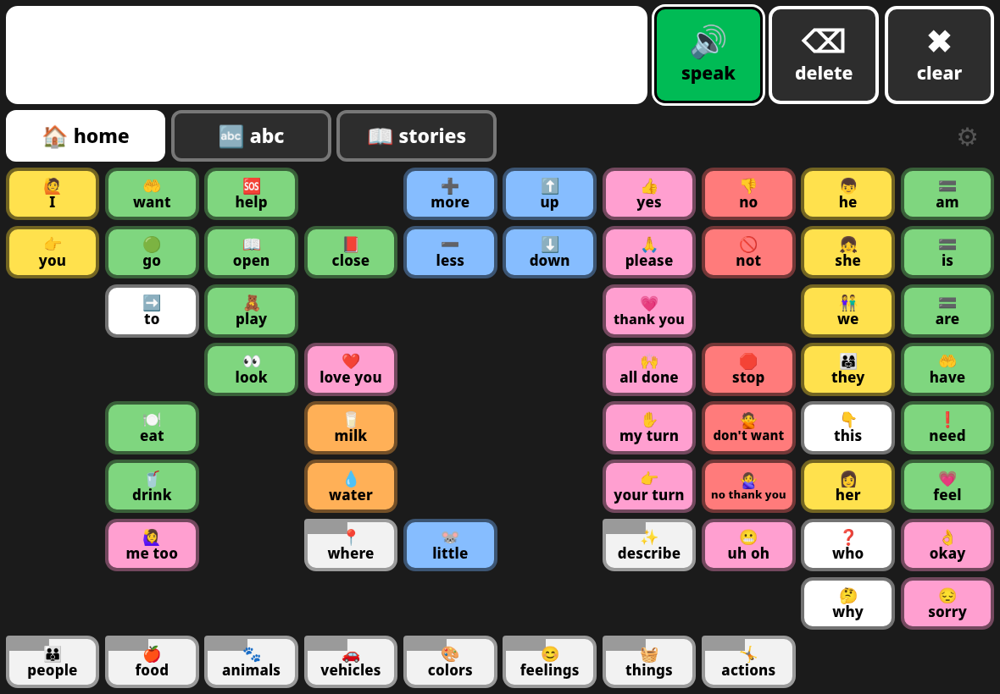
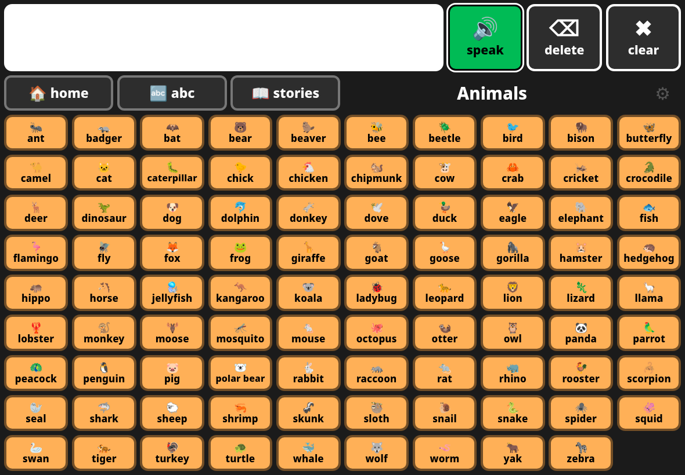
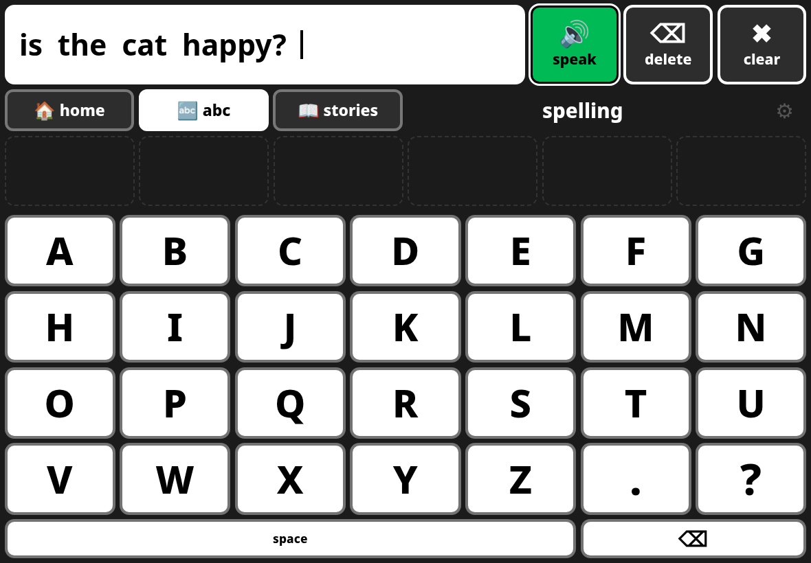
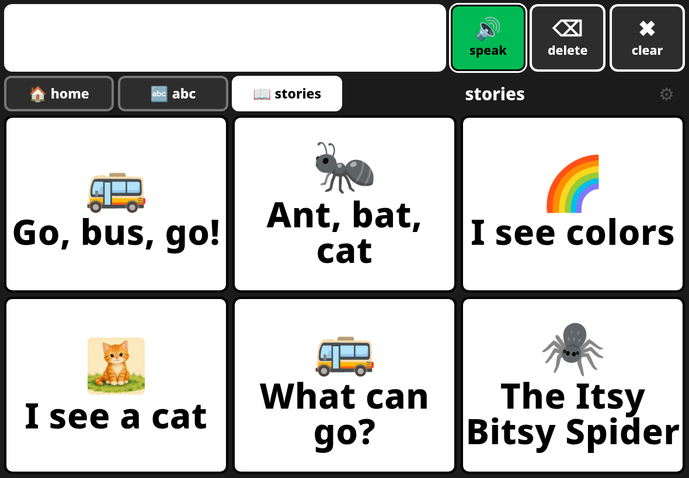
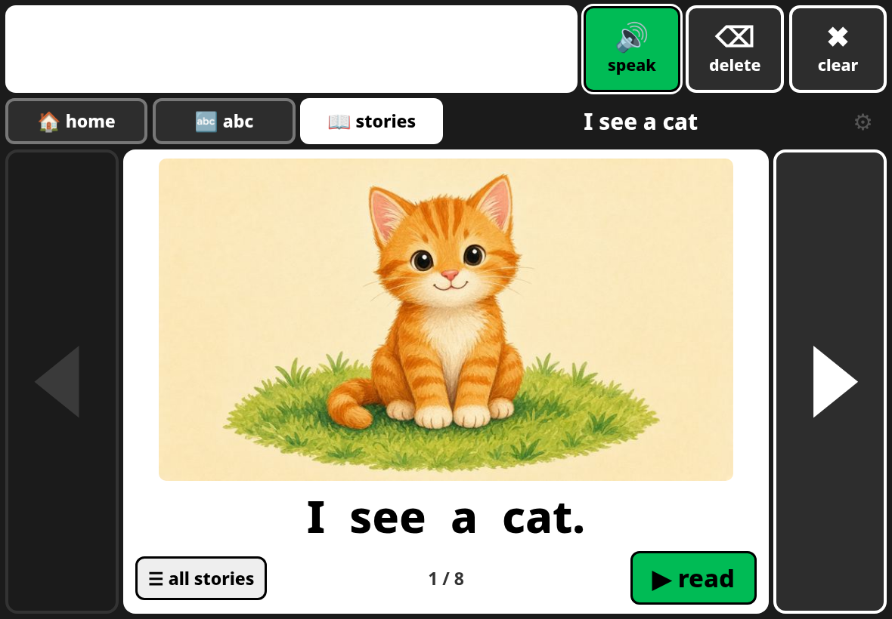
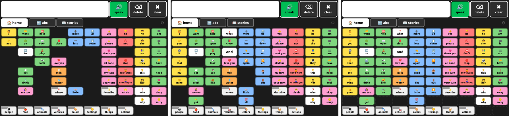
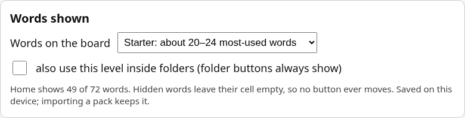
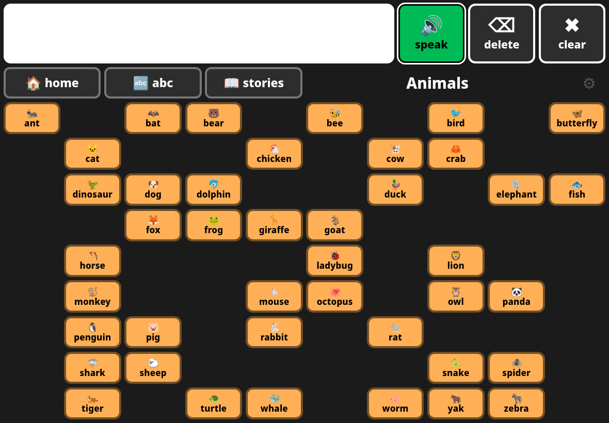
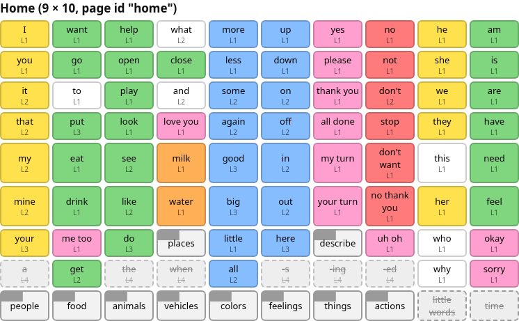

# Word Board

A simple, offline-capable AAC (communication board) web app for iPad. Plain HTML/CSS/JS:
no build step, no frameworks, no CDNs, no analytics, no network calls.

**Current version: 1.3.2.** Try it: [neuresthetics.github.io/anova_language_dev_public](https://neuresthetics.github.io/anova_language_dev_public/).
Set it up on your own iPad for free: [docs/SETUP.md](docs/SETUP.md).

| Home (starter level) | Home (full) | Animals |
|---|---|---|
|  |  |  |
| **Keyboard** | **Stories** | **Illustrated story** |
|  |  |  |

More (landscape and portrait) in [docs/screenshots/](docs/screenshots/).

**Since 1.3.0 the whole board is built in.** `words.js` holds every word (starter, middle and
full tiers, with fixed positions and levels) and `stories.js` holds the non-personal stories,
with their illustrations in `media/stories/`. Nothing needs to be imported: new words arrive
with app updates. The parent setting *Words shown* (starter / middle / full / custom) picks
the tier.

**Private content** (family photos, the "My family" story, recordings) lives only in
`private/overlay.js` (+ `private/photos/…`, `private/recordings/…`) in the private copy of the
app. `index.html` loads it if it exists; the public copy simply doesn't have that folder
(`private/` is git-ignored here). Photos/recordings added on the iPad stay in IndexedDB on that
device and are merged on top. Pack import (below) still works as a fallback: an imported pack
adds its photos/recordings/stories on top of the built-in board; it only replaces the board if
its pack.json has `"replace": true`.

## What it does

- **Message bar** (top). Tapped words and letters collect here. **speak** says the whole
  message, **delete** removes the last word (on the keyboard it removes the last letter),
  **clear** empties the bar. Tapping the bar also speaks it. While speaking, the word being
  said is highlighted (when the voice reports word timing).
- **home (WORDS).** A fixed 9 × 10 grid of core words: I/you/he/she/we/they/this/her,
  helper verbs (is, are, am, have, need, feel), want/go/help/eat/drink, **to**, more/less,
  open/close, up/down, protest phrases (no thank you, don't want), quick replies (your
  turn, uh oh, me too, okay, sorry, love you) and question words (who, why). Opposites sit
  side by side (more/less, open/close, up/down, big/little). Tapping a word **speaks it right away and
  adds it to the bar**. Folder buttons (bottom row) open category pages. The **home** tab
  always sits in the same place and goes back to the home page.
- **Folders.** people, food, animals, vehicles, colors, feelings, things, actions,
  describe and where. **animals** holds 89 animals in A–Z order (ant … zebra).
- **abc (KEYBOARD).** A–Z in **alphabetical order**, **.** and **?**, a wide **space** bar and
  a **⌫ backspace** key. Pressing space speaks the finished word. Tapping **.** or **?** ends
  the sentence and **reads the whole typed sentence aloud** (so **?** gets question
  intonation). On an empty bar the key just says "period" or "question mark". The prediction row above the keys suggests words that start with the
  typed letters (from the visible buttons plus the pack's `knownWords`); tapping a
  suggestion finishes and speaks the word. It can be turned off.
- **stories.** Simple read-along books. **Turning a page never speaks.** The app speaks only
  when a word is tapped (that word) or **▶ read** is tapped (the page). There are big
  back/next arrows on both sides. This fits an adult reading aloud and pointing.
  The built-in stories are *Go, bus, go!*, *Ant, bat, cat*, *I see colors*, *I see a cat*
  (full-colour illustrations), *What can go?* and *The Itsy Bitsy Spider*.
  Each page can show a photo (`pic`), a small emoji **scene** (`scene`, 2–6 emoji, the main
  subject bigger) or one big `emoji`. The **stories** tab always opens the list of stories,
  laid out so every tile fits on screen when possible.
- **Presses.** A button counts when the finger lifts, however long it was held, as long as the
  finger is still on the button or within about 28 px of it. Slow presses, holds and wiggles
  all work; sliding well off the button cancels. Long-press menus and text selection are off.
- **Words shown** (parent settings, top section): **Starter** (the most-used words; about
  half of home), **Middle**, **Full** (every word) or **Custom** (tap words in the editor to show or
  hide them). Words are **masked, never moved**: a hidden word leaves an empty cell, so every
  visible button keeps its place as more words are revealed. Folder buttons always show; the level
  applies to Home, and optionally inside folders too. Each word's priority comes from its optional
  `level` field (1 = starter, 2 = middle, 3 = full) in `words.js`. A pack can set its default
  with `config.wordsShown`; once a parent picks a level it is saved on the device and kept when
  a pack is imported again.
- **Parent settings** (hold the dim ⚙ gear for 2 seconds; triple tap is optional):
  voice, speed, pitch, volume; text case; pictures on/off; prediction; tap-repeat guard;
  story read mode; optional pack import/export; hide/show words; add photos from the
  camera or photo library; opt-in usage log.

No animations, no ads, no sounds except speech and recordings.

## How the board grows with her language

The board is built to grow without ever moving a button. Every word has a fixed place and a
level, and the parent decides how much of the board is visible.



*Home at **Starter**, **Middle** and **Full** (left to right). The buttons that show stay in
the same place at every level.*

**Three levels.** Each word in `words.js` has a `level`: 1 = starter, 2 = middle, 3 = full.
In 1.3.2 the built-in board has 275 words plus 10 folder buttons:

| Level | Home shows | Whole board (with *levels in folders* on) |
|---|---|---|
| **Starter** (default) | 49 of 72 home words | 129 words |
| **Middle** (starter + middle) | 66 of 72 | 182 words |
| **Full** | all 72 | all 275 |

Folder buttons always show at every level.



**Levels inside folders.** By default the level only applies to Home, and every folder shows
all of its words. Tick *also use this level inside folders* (⚙ → Words shown) to mask folder
pages too. For example, the animals folder at Starter then shows 42 of its 89 animals, each
in its usual place:



**Turning single words on or off.** ⚙ → *Words: show / hide and photos* shows every page as a
grid. Each word carries its level (L1/L2/L3), and empty cells show their row and column.
With *hide / show it* selected, tapping a word flips it on or off. The first tap switches
*Words shown* to **Custom**, starting from the level you were on, so you can add one new word
at a time ahead of the next level. Folder buttons can be hidden here too. These choices are
saved on that iPad.



**Positions never move.** A hidden or not-yet-shown word leaves an **empty cell** instead of
letting other buttons slide over, so a button she has learned is in the same spot at
Starter, Middle, Full and Custom. New words only go into empty cells. When the app loads, a
word whose place is already taken is reported as a problem and doesn't take the place. Words
from a pack that are also built into the app keep their built-in position, so an update
can't scramble the layout (only a pack marked `"replace": true` uses its own layout). This is
what lets motor memory carry over as the vocabulary grows.

**Opposites sit together.** On Home the pairs are stacked: more above less, up above down, on
above off, in above out, big above little. Open is next to close and yes is next to no. In
the describe and actions folders they sit side by side: hot/cold, fast/slow, full/empty,
clean/dirty, loud/quiet, give/take and sit/stand.

**Adding words.** Add a word to `words.js` with an empty `row`/`col` and a `level`. It ships
to every device with the next app update, and there's nothing to import. For words only one
child needs, an optional personal pack (see below) can add words into empty cells on that
iPad.

**Tracking growth.** The opt-in *usage log* (⚙ → Usage log, off by default) records the time
and word for every word button tapped and every finished typed word. It stays on the iPad,
and you can export it as CSV or JSON. It's a simple way to see which words she uses, so you
know when it's time to reveal more.

## Colour coding (modified Fitzgerald key)

| Colour | Group | Examples |
|---|---|---|
| yellow | people / pronouns | I, you, mom, me |
| green | verbs (actions) | want, go, help, eat |
| blue | descriptors: describing, location, colour, feeling words | more, up, on, red, happy |
| orange | nouns (things) | milk, water, cat, car |
| pink | social words | yes, please, thank you, all done, my turn |
| red | negation / stop | no, not, stop |
| white | little words (`type: "little"`) | and, the |
| white with a black tab | folder (opens a category page) | animals, food |

Location words (up, down, on, out) are shown blue with the descriptors, and **stop** is red
with the negation words, as many core boards do. Change a word's `type` to recolour it.

## Motor planning: positions never move

Every button has an explicit `row`/`col` on a fixed grid (home is 9 × 10; each page sets its own `rows`/`cols`). Empty cells
stay blank. Hiding a word blanks its cell and moves nothing else. Adding a word only fills
an empty cell. Keep these rules when editing:

1. Never change the `row`/`col` of a word she already uses.
2. Put new words only into empty cells. Parent settings → *Words* shows every empty cell
   as `r4 c1` etc.
3. To remove a word for a while, hide it instead of deleting it.

The app checks the layout when it loads. Two words in one cell, a cell outside the grid,
or a folder pointing to a missing page is listed in parent settings and in the console,
and the first word keeps the cell.

## Editing words

**Built-in board:** `words.js` (comments at the top explain every field). This is the normal
way to add words: they ship with the next app update, nothing to import.

**Personal pack (optional):** a pack's `pack.json` uses the same `pages`/`words` format under
`config`. Rebuild the pack and import it again (see below).

```js
{ id: "juice", label: "juice", page: "food", row: 1, col: 5, type: "noun", emoji: "🧃" }
```

Optional fields:
- `say`: what the voice says if it should differ from the label. The starter board uses
  `say: "eye"` on **I**, because iOS reads a lone "I" as "capital I". The app also applies
  "eye" to a typed **i** and to "I" in stories, even if a pack forgets the `say` field.
- `audio`: a recording, e.g. `"recordings/milk.m4a"`. If the recording is in the pack it
  plays; if it is missing or cannot play, the voice says the word instead.
- `image`: a photo, e.g. `"photos/cup.jpg"` (or add one on the iPad).
- `hidden: true`.

## Personal packs (optional)

Since 1.3.0 you don't need a pack: every word and story is built in. A pack is only for
adding your own photos, recordings or stories on one iPad.


A pack is either a `.zip` (holding `pack.json` plus `photos/…` and `recordings/…`) or a
single `.json` with the media embedded. `pack.json` looks like this:

```json
{ "format": "wordboard-pack", "version": 1, "name": "My pack",
  "config": { "pages": [...], "words": [...], "knownWords": ["cat", "dog"], "wordsShown": "starter" },
  "stories": [ { "id": "s1", "title": "…", "emoji": "🚌", "pages": [ { "text": "…", "scene": ["🐶", "👀", "🌧️"], "sceneMain": 2, "emoji": "🌧️" },
                                                                 { "text": "…", "pic": "photos/p1.jpg" } ] } ],
  "includeSampleStories": true }
```

To build importable files from a pack folder:

```
node tools/make-pack.js <pack-folder> <out-folder> <name>
```

This checks the pack for position collisions and writes `<name>.zip` and `<name>.json`.

**On the iPad:** open the app → hold ⚙ for 2 s → *Import pack* → choose the file in Files.
Import in the **Home Screen app itself**: iOS keeps Home Screen web apps' storage separate
from Safari's. After importing, photos can be added under *Words* (choose "add or change
its photo" and tap a word) or under *Stories*. **Export pack (.zip)** or **Share / Save to
Files** makes a backup with all photos and recordings. Back up after changes: deleting the
Home Screen app can delete its storage.

Recordings: record in Voice Memos, share/save as `.m4a`, name it like the word
(`milk.m4a`), put it in the pack's `recordings/` folder, add `audio: "recordings/milk.m4a"`
to the word, then rebuild and re-import.

## Speech notes (iOS)

- Speech uses the Web Speech API (`speechSynthesis`) in en-US and needs no network for
  on-device voices.
- iOS loads voices late and doesn't always fire `voiceschanged`. The app polls for about
  10 s, and until voices appear it speaks with the default en-US voice.
- iOS only allows speech/audio to start from a tap. Every sound starts from a tap. The app
  also primes the audio engine on the first touch, so a recording followed by speech works.
- **Siri voices are not available to web apps.** For a nicer voice, download an *Enhanced*
  or *Premium* English voice: iPad **Settings → Accessibility → Spoken Content → Voices →
  English**. Then pick it under ⚙ → Voice (or leave it on *Automatic*, which prefers
  Premium/Enhanced en-US voices). Novelty voices are hidden unless you ask for them.
- Rate and pitch feel different from voice to voice; some iOS voices ignore pitch.
- Word highlighting while speaking depends on the voice sending word-boundary events. If
  highlighting drifts in stories, set *Stories ▶ read button* to "one word at a time".
- Turn the iPad volume up. Speech and recordings follow the media volume.

## Getting it onto the iPad (private options, none done yet)

"Add to Home Screen" (Safari → Share → Add to Home Screen) gives a full-screen app icon.
Working **offline** needs the service worker, and browsers only run service workers on
**https://** (or `localhost`).

**(a) Local server on the home network.** Easiest to try:
`python3 -m http.server 8000` in this folder, then open `http://<computer-ip>:8000` on the
iPad. Plain `http://` to a LAN address is **not a secure context**, so there is no service
worker and no offline use. The app works only while the computer is serving, and a pack
imported on a plain-http address also lives on that address. For offline use on the LAN,
serve it over HTTPS with a certificate the iPad trusts. One private way:
[Tailscale](https://tailscale.com) with `tailscale serve`, which gives an HTTPS
`*.ts.net` address that only your own devices can reach. After the first load it works
with no network.

**(b) Private host with a password.** A static host behind a login (for example Cloudflare
Pages + Cloudflare Access, or a host with basic-auth). This gives HTTPS, so offline works
after the first visit. Log in once in Safari, then Add to Home Screen. Login redirects can
misbehave inside a Home Screen app, so load it once while logged in; after that it runs from
the offline cache. Only the generic shell is on the host. Personal content stays on the
iPad.

**(c) One self-contained HTML file** (`dist/aac.html`, built with
`node tools/build-single.js`). Everything is inlined in one file with no external requests.
Limits on iPad:
- The Files app's preview (Quick Look) **does not run JavaScript**, and current iPadOS
  Safari won't open local HTML files. So an AirDropped `aac.html` does **not** work by
  tapping it in Files. It needs a third-party app with a real web view (for example an
  "HTML viewer" app), and whether speech works there depends on that app.
- There is **no service worker** from a file, so there is no install/offline caching. It is
  "offline" only in the sense that the file itself needs no network.
- The single file is still handy to put on a private host as one file (option b), where
  it behaves like the normal app minus offline caching.

## Files

| File | What it is |
|---|---|
| `index.html` | app page |
| `styles.css` | layout and colours |
| `app.js` | app logic (speech, grid, keyboard, stories, parent mode, packs) |
| `store.js` | on-device storage (IndexedDB) and a small zip reader/writer |
| `words.js` | the built-in board: every word, position and level (starter/middle/full) |
| `stories.js` | built-in stories |
| `media/stories/` | story illustrations |
| `sw.js` | service worker (offline) |
| `manifest.json`, `icons/` | Home Screen install |
| `tools/make-pack.js` | builds a pack `.zip`/`.json` from a pack folder |
| `tools/build-single.js` | builds `dist/aac.html` |
| `tools/icon.html` | icon source |
| `dist/aac.html` | single-file build (story illustrations are not inlined) |
| `docs/SETUP.md` | step-by-step setup guide for parents |
| `docs/screenshots/` | screenshots of 1.3.2 (iPad landscape 1180 × 820 and portrait 820 × 1180) |

After changing app files, reopen the app twice: the first launch fetches the update in
the background and the second shows it. **Bump `CACHE` in `sw.js` on every release** so
devices drop the old offline copy.

## Tip: Guided Access

iPad **Settings → Accessibility → Guided Access** locks the iPad into this app (triple-click
the side/top button to start it). It stops accidental exits.
