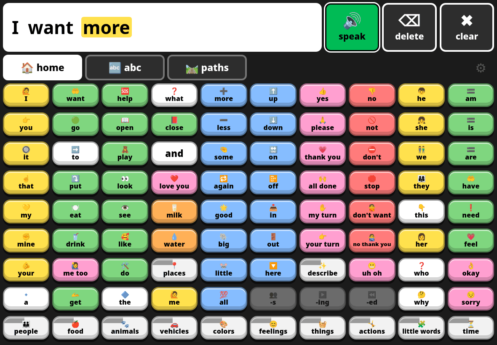

# Word Board

**A free talking word board (AAC) for iPad. No account, no app store, no tracking.**
Version **1.6.0**.

## Start today (2 minutes)

1. On the iPad, open **https://neuresthetics.github.io/anova_language_dev_public/** in Safari.
2. Tap **Share** (the square with the arrow), then **Add to Home Screen**, then **Add**.
3. Open **Word Board** from the home screen. Done. It works offline after the first open.



*Full level, Button look: chunky. [Portrait](docs/screenshots/chunky-full-portrait.png) ·
[Paths menu](docs/screenshots/chunky-paths-landscape.png) ·
[a finished Paths sentence](docs/screenshots/chunky-paths-sentence-landscape.png)*

**Pick a level.** Hold the ⚙ gear for 2 seconds to open parent settings. Words are tiered
roughly by age: **Starter (about 2)**, **Middle (about 3)**, **Expanded (about 4)**,
**Sentences (about 5)**, **Full (about 6+)**. The ages are approximate, not a test or an
assessment. Start where it feels easy and turn it up any time if your child is ahead.

**Make it look right.** Parent settings → *Look*: contrast (normal or high), text size
(normal, large, larger), board colour (dark, light, deep blue) and **Button look**:
**classic** (the default), **chunky** (3D keys that sink when pressed), **tint** (pale tiles
with a thick colour edge and bigger pictures) or **pebble** (soft rounded pastel buttons).
Only the surface of the buttons changes: every word keeps its place and its colour.

**Share it.** Parent settings → *Share Word Board* has a share button, a copy-link button and a
QR code. (Sharing is only in parent settings, never on the child's board.)

**Feedback or requests.** Email **[neuresthetics@gmail.com](mailto:neuresthetics@gmail.com?subject=Word%20Board%20feedback)**
(subject "Word Board feedback"), or open an issue on
[GitHub](https://github.com/neuresthetics/anova_language_dev_public/issues/new/choose).

**Privacy.** No accounts, no analytics, no tracking, no ads. Everything stays on the device;
nothing leaves it unless you send it yourself (for example, an email you write).

*Want your own copy to change?* Fork the repo and follow [docs/SETUP.md](docs/SETUP.md).

---

## How it works

A simple, offline-capable AAC (communication board) web app for iPad. Plain HTML/CSS/JS:
no build step, no frameworks, no CDNs, no analytics, no network calls.

**The whole board is built in.** `words.js` holds every word (about 420, with fixed
positions and age-tiered levels), `paths.js` the Paths sentence patterns and `stories.js` the
non-personal stories, with their illustrations in `media/stories/`. Nothing needs to be
imported or downloaded: new words arrive with app updates. The parent setting *Words shown*
picks the level.

**Private content** (family photos, the "My family" story, recordings) lives only in
`private/overlay.js` (+ `private/photos/…`, `private/recordings/…`) in the private copy of the
app. `index.html` loads it if it exists; the public copy simply doesn't have that folder
(`private/` is git-ignored here). Photos/recordings added on the iPad stay in IndexedDB on that
device. Parent settings can save a backup of those device additions and restore it later.

## What it does

- **Message bar** (top). Tapped words and letters collect here. **speak** says the whole
  message, **delete** removes the last word (on the keyboard it removes the last letter),
  **clear** empties the bar. Tapping the bar also speaks it. While speaking, the word being
  said is highlighted (when the voice reports word timing).
- **home (WORDS).** A fixed grid of word buttons. Tapping a word **speaks it right away and
  adds it to the bar**. Folder buttons (bottom row) open category pages. The **home** tab
  always sits in the same place and goes back to the home page. After a word inside a folder
  she stays on that page, unless *go back to Home after picking a word in a folder* is on.
- **abc (KEYBOARD).** A–Z in **alphabetical order**, **.** and **?**, plus a wide **space**
  bar. Pressing space speaks the finished word. **.** or **?** ends the last word; it shows in
  the message bar and stays in the spoken sentence (so **?** gets question intonation). The prediction row above the keys suggests words that start with the
  typed letters (from the visible buttons plus the board's `knownWords` list); tapping a
  suggestion finishes and speaks the word. It can be turned off.
- **paths.** Speech-pattern practice that builds short, grammatical sentences ("I want
  milk.", "I like swimming."); an automatic grammar audit checks every path. The tab bar is **home**, **abc**, **paths**.
  Large pattern cards open a short sentence one blank at a time. Starter: **I want …**,
  **I want more …**, **Help me**, **I see …**, **Stop.**, **I'm all done.** Middle adds
  **I don't want …**, **I go to …**, **I like …**. Expanded adds **Who / what is …?**,
  **Where is …?** (the board word is **where?**), and **Open the … / Close the …**.
  Sentences and Full add **I can …**, **Put it on / in …**, **I want … please** (please or
  thank you), and **I like …ing** (optional **-ing** on the activity). A fixed word is one
  big button. An open slot is 2–6 big choice buttons, coloured with the Fitzgerald key when
  the word is on the board. Choices use `words.js` labels, emoji and levels, and only words
  at the current *Words shown* level. Each tap speaks that word; a parent can turn that off
  so the phrase is spoken at the end. Along the bottom, in a fixed order: **← undo** (takes
  back the last word; disabled on the pattern list and until a word has been picked),
  **all patterns** (returns to the pattern list; disabled while that list is already showing),
  **say whole**, and **→ words** (copies a finished phrase into the message bar and opens
  home). A pattern is hidden when its main word is hidden. Parent settings can show or hide
  the Paths tab (the slot stays, so home and abc do not move), speak on each tap, allow
  **→ words**, follow Words shown or pick a pattern set through Expanded, Sentences, or all,
  and set how many choices an open slot shows. If the usage log is on, open slots can float
  words she has used lately after the usual core words.
- **stories.** Still in the app (`stories.js` and `media/stories/`) and still editable under
  parent settings, but **not on the tab bar**. Turning a page never speaks. The app speaks only
  when a word is tapped (that word) or **▶ read** is tapped (the page).
- **Presses.** A button counts when the finger lifts, however long it was held, as long as the
  finger is still on the button or within about 28 px of it. Slow presses, holds and wiggles
  all work; sliding well off the button cancels. Long-press menus and text selection are off.
- **Words shown** (parent settings, top section), roughly by age. On the home board:
  **Starter** (about 2): the 49 most-used words, also as **Starter (big buttons)**;
  **Middle** (about 3): 67; **Expanded** (about 4): 75; **Sentences** (about 5): 78, adding
  *when*, word endings and more little words; **Full** (about 6+): every word, about 420 in
  all, including the Conversation words (time, thinking, school, social phrases).
  **Custom** lets you tap words to show or hide them one at a time. Words are **masked, never
  moved**: a hidden word leaves an empty cell, so every visible button keeps its place as more
  words are revealed. Folder buttons always show; the level applies to Home, and optionally
  inside folders too. A level a parent picks is saved on the device and kept across updates.
- **Parent settings** (hold the dim ⚙ gear for 2 seconds; triple tap is optional):
  voice, speed, pitch, volume; **Look** (contrast, text size, board colour, Button look);
  text case; picture and word / picture only / word only; clear button (hold, tap or
  hidden); hold time; spacing; prediction; tap-repeat guard;
  story read mode; Paths (show the tab, speak each word, copy to Words, which pattern set,
  how many open-slot choices, hide a pattern whose word is hidden, prefer recent words from
  the usage log); **go back to Home after picking a word in a folder** (off by default:
  she stays in the folder; when on, the word is still spoken and added, then the board
  returns to Home); hide/show words; add photos from the camera or photo library; a
  backup of photos and recordings added on the device; opt-in usage log; **Share Word
  Board** (share button, copy link, QR code) and **Send feedback** (an email you write).
  Everything is saved on this device.

No animations, no ads, no sounds except speech and recordings.

## Colour coding (modified Fitzgerald key)

| Colour | Group | Examples |
|---|---|---|
| yellow | people / pronouns | I, you, mom, me |
| green | verbs (actions) | want, go, help, eat |
| blue | descriptors: describing, location, colour, feeling words | more, up, on, red, happy |
| orange | nouns (things) | milk, water, cat, car |
| pink | social words | yes, please, thank you, all done, my turn |
| red | negation / stop | no, not, stop |
| white | little words (`type: "little"`) | and, the |
| white with a black tab | folder (opens a category page) | animals, food |

Location words (up, down, on, out) are shown blue with the descriptors, and **stop** is red
with the negation words, as many core boards do. Change a word's `type` to recolour it.

## Motor planning: positions never move

Every button has an explicit `row`/`col` on a fixed grid (home is 9 × 10). Empty cells
stay blank. Hiding a word blanks its cell and moves nothing else. Adding a word only fills
an empty cell. Keep these rules when editing:

1. Never change the `row`/`col` of a word she already uses.
2. Put new words only into empty cells. Parent settings → *Words* shows every empty cell
   as `r4 c1` etc.
3. To remove a word for a while, hide it instead of deleting it.

The app checks the layout when it loads. Two words in one cell, a cell outside the grid,
or a folder pointing to a missing page is listed in parent settings and in the console,
and the first word keeps the cell.

## Editing words

The board is `words.js` (comments at the top explain every field). In your own copy, edit
it and publish; devices pick up the change on their next update.

```js
{ id: "juice", label: "juice", page: "food", row: 1, col: 5, type: "noun", emoji: "🧃" }
```

Optional fields:
- `say`: what the voice says if it should differ from the label. The starter board uses
  `say: "eye"` on **I**, because iOS reads a lone "I" as "capital I". The app also applies
  "eye" to a typed **i** and to "I" in stories.
- `audio`: a recording, e.g. `"recordings/milk.m4a"`. If the recording is there it
  plays; if it is missing or cannot play, the voice says the word instead.
- `image`: a photo, e.g. `"photos/cup.jpg"` (or add one on the iPad).
- `hidden: true`.

## Photos, recordings and backups

Photos can be added on the iPad: parent settings → *Words* ("add or change its photo", then
tap a word) or *Stories*. They are shrunk to 640 px and stay on that device. Do this in the
**Home Screen app itself**: iOS keeps a Home Screen app's storage separate from Safari's.

Parent settings → *Board, private content and device backup* can **export** those device
additions (photos, recordings, stories) as a `.zip`, **Share / Save to Files**, and restore a
saved backup. Back up after changes: deleting the Home Screen app can delete its storage.

## Speech notes (iOS)

- Speech uses the Web Speech API (`speechSynthesis`) and needs no network for on-device
  voices.
- iOS loads voices late and doesn't always fire `voiceschanged`. The app polls for about
  10 s, and until voices appear it speaks with the default en-US voice.
- iOS only allows speech/audio to start from a tap. Every sound starts from a tap. The app
  also primes the audio engine on the first touch, so a recording followed by speech works.
- **Siri voices are not available to web apps.** For a nicer voice, download an *Enhanced*
  or *Premium* English voice: iPad **Settings → Accessibility → Spoken Content → Voices →
  English**. Then pick it under ⚙ → Voice (or leave it on *Automatic*, which prefers
  Premium/Enhanced voices in the iPad's own English, for example en-GB, and otherwise
  en-US). Novelty voices are hidden unless you ask for them.
- Rate and pitch feel different from voice to voice; some iOS voices ignore pitch.
- Word highlighting while speaking depends on the voice sending word-boundary events. If
  highlighting drifts in stories, set *Stories ▶ read button* to "one word at a time".
- Turn the iPad volume up. Speech and recordings follow the media volume.

## Other ways to host it (optional)

Most people should just use the live link in *Start today*. These options are for running
your own copy. "Add to Home Screen" (Safari → Share → Add to Home Screen) gives a full-screen
app icon.
Working **offline** needs the service worker, and browsers only run service workers on
**https://** (or `localhost`).

**(a) Local server on the home network.** Easiest to try:
`python3 -m http.server 8000` in this folder, then open `http://<computer-ip>:8000` on the
iPad. Plain `http://` to a LAN address is **not a secure context**, so there is no service
worker and no offline use. The app works only while the computer is serving, and photos
added on a plain-http address also live on that address. For offline use on the LAN,
serve it over HTTPS with a certificate the iPad trusts. One private way:
[Tailscale](https://tailscale.com) with `tailscale serve`, which gives an HTTPS
`*.ts.net` address that only your own devices can reach. After the first load it works
with no network.

**(b) Private host with a password.** A static host behind a login (for example Cloudflare
Pages + Cloudflare Access, or a host with basic-auth). This gives HTTPS, so offline works
after the first visit. Log in once in Safari, then Add to Home Screen. Login redirects can
misbehave inside a Home Screen app, so load it once while logged in; after that it runs from
the offline cache. Only the generic shell is on the host. Personal content stays on the
iPad.

**(c) One self-contained HTML file** (`dist/aac.html`, built with
`node tools/build-single.js`). Everything is inlined in one file with no external requests.
Limits on iPad:
- The Files app's preview (Quick Look) **does not run JavaScript**, and current iPadOS
  Safari won't open local HTML files. So an AirDropped `aac.html` does **not** work by
  tapping it in Files. It needs a third-party app with a real web view (for example an
  "HTML viewer" app), and whether speech works there depends on that app.
- There is **no service worker** from a file, so there is no install/offline caching. It is
  "offline" only in the sense that the file itself needs no network.
- The single file is still handy to put on a private host as one file (option b), where
  it behaves like the normal app minus offline caching.

## Files

| File | What it is |
|---|---|
| `index.html` | app page |
| `styles.css` | layout and colours |
| `app.js` | app logic (speech, grid, keyboard, paths, stories, parent settings, backups) |
| `store.js` | on-device storage (IndexedDB) and a small zip reader/writer |
| `words.js` | the board: every word, its place and its level |
| `paths.js` | Paths patterns (which phrases, which board words fill each blank) |
| `stories.js` | generic sample stories (not on the tab bar) |
| `sw.js` | service worker (offline) |
| `manifest.json`, `icons/` | Home Screen install |
| `tools/make-pack.js` | (advanced) builds a device-additions `.zip`/`.json` from a folder |
| `tools/build-single.js` | builds `dist/aac.html` |
| `tools/icon.html` | icon source |
| `dist/aac.html` | single-file build |
| `docs/screenshots/` | screenshots of the generic board (the `chunky-*` previews are 1.6.0) |

After changing app files, reopen the app twice: the first launch fetches the update in
the background and the second shows it. **Bump `CACHE` in `sw.js` on every release** so
devices drop the old offline copy.

## Tip: Guided Access

iPad **Settings → Accessibility → Guided Access** locks the iPad into this app (triple-click
the side/top button to start it). It stops accidental exits.
